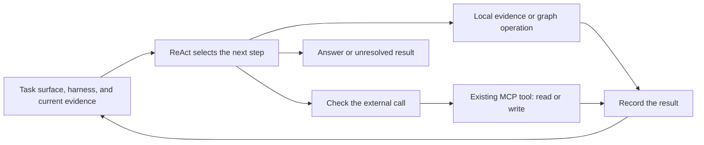

# Oak

**Make implicit task relationships explicit around a simple ReAct loop.**

This project is inspired by the OaK paper.
It combines an ontology, typed functions, observed evidence, and checked tool calls to improve agent reliability.

**External operations come from prebuilt Model Context Protocol (MCP) tools.**
Other developers and software engineering teams supply and maintain those tools.
They provide the implementations for operations such as searching records, creating bookings, or updating an account.
Oak selects among granted tools and builds explicit task dependencies, relations, and conditions around their use.

A prebuilt MCP tool is a unit of external work.
A ReAct loop is the agent execution unit that selects and uses those tools.
The ontology harness makes the dependencies between these operations explicit.

## Why I am building this

I see evaluations, or evals, as a necessary part of building an agent.
An agent can identify an implicit dependency during execution.
Longer trajectories require it to retain and apply more relationships and conditions.

What if a construction loop could use eval results to build explicit, typed dependencies, relations, and conditions?
Later executions could inspect and check them.
I want to explore incentives for supported improvements and disincentives for regressions, unnecessary definitions, and unsupported assumptions.

The current implementation uses acceptance and rejection checks for this feedback.
A candidate must pass validation and every saved case before acceptance.
Unsupported changes are rejected, and unresolved causes remain recorded.
Training changes the harness definitions. Model weights remain fixed.

## Start with a task surface

A **task surface** defines an agent's objective, responsibilities, rules, and boundaries.
A **tool grant** permits access to one selected, existing MCP tool.

For a booking task:

1. Define the objective, such as finding and booking a suitable property.
2. Define responsibilities and boundaries, such as which booking operations are permitted.
3. Grant existing tools for property search, policy lookup, and booking creation.
4. Supply sample queries, selected tools, and success descriptions, including the requested dates and party size.
5. Set execution limits and prepare the environment for the intended operations.

An **ontology** defines the task's concepts and relations, such as a property and its booking policy.
The **working graph** holds facts obtained from actual tool observations.
A **typed function** declares input and output types for local graph computations or checks.
The **harness** combines these definitions with mappings and operation checks around the agent loop.

## One ReAct cycle

**ReAct** means reasoning and acting through a loop of decisions, operations, and observations.
With a harness attached, each cycle uses the original request, ontology definitions, and available evidence.

1. Inspect the request and previous results, using local evidence or graph operations when necessary.
2. Select the next operation, then run the applicable execution checks.
3. Record the result, update the graph from new observations, and continue or finish.

| Operation | What it does |
| --- | --- |
| `read_evidence` | Reads saved observations, results, and complete definitions. |
| `run_function` | Executes a saved typed function on the working graph. |
| `query_graph` | Executes a temporary typed graph plan without adding a saved function. |
| Granted MCP tool | Runs an existing provider implementation to read external data or perform an action. |

**Write operations execute through the prebuilt MCP tools.**
A booking tool can create a reservation after its declared checks pass.
Read and write responses both supply graph evidence, such as a reservation identifier and status.
An unknown action outcome stops the run without an automatic retry.

The agent chooses when to inspect the graph.
A separate inspection call is not mandatory at the start of every cycle.
The dispatcher checks grants, arguments, source restrictions, and declared conditions before an external call.
A minimum-night condition can block a two-night booking at a property that requires three nights.

## The nine operator capabilities

The starting library follows Appendix B of the [OaK paper](docs/paper/source/oak-2608.22974v1.pdf).
These capabilities process requests and graph evidence inside Oak.
They support the use of external MCP tools.
The count describes the paper's public library, rather than the number of graph-plan step names.
Request extraction runs outside the graph plan, and the runtime shares a filter step across several predicate types.

| Capability | What it provides |
| --- | --- |
| Request extraction | Typed request values with source evidence. |
| Entity lookup | Relevant records selected by type, identity, properties, name, or text. |
| Relation traversal | Routes through connected records, policies, accounts, and other entities. |
| Property projection | The fields needed for the next operation, with their evidence references. |
| Categorical filtering | Conditions on types, categories, and statuses. |
| Connectivity filtering | Conditions on relationships, such as an offer belonging to a specified supplier. |
| Numeric filtering | Comparisons for capacity, cost, quantities, and minimum stays. |
| Set-overlap filtering | Any-match, all-match, or minimum-overlap conditions for several requested features. |
| Aggregation | Counts, totals, minima, maxima, and averages, including grouped results. |

A query can combine these capabilities and follow existing relations without creating a dedicated function.
Missing observations require evidence acquisition, not automatic schema growth.
See the [operator rationale](docs/system.md#why-the-nine-operator-capabilities-matter) for the purpose and limits of each capability.

## The building cycle

Construction uses saved cases and their outcomes to build and validate the harness.
One internal semantic evaluator judges task success from recorded evidence.

1. Explore the existing, granted MCP tools and collect initial requirement and schema proposals.
2. Run every saved case through basic ReAct to record a baseline.
3. Reuse a compatible accepted candidate, or construct the minimum initial definitions.
4. Validate the candidate and run all saved cases through ReAct with that harness.
5. Compare outcomes and inspect failures, existing routes, and supporting evidence.
6. Apply a targeted change only when a repair review supports a specific definition gap.
7. Validate the change and rerun all saved cases before acceptance.

The runtime, evaluator, tool grants, and operator implementations stay fixed during this process.
The construction loop changes harness definitions and leaves MCP tool implementations with their providers.
One verified gap is sufficient to consider a change.
Tool errors, context limits, and uncertain causes do not automatically authorize repair.
Successful routes remain execution evidence.

## The inference cycle

Inference applies an accepted harness to a new query.

1. Select a validated candidate that matches the current task inputs and runtime.
2. Prepare the original request and start a fresh working graph.
3. Run ReAct with saved functions, temporary graph queries, and granted MCP tools.
4. Record actual calls and results, including facts returned by successful writes.
5. Finish with a supported answer, an observed action outcome, or an explicit unresolved result.

Inference keeps accepted definitions fixed and updates only the working graph.
It uses one agent and does not run construction or the training evaluator.

## Relationship to the paper

The research basis is *Toward Effective and Reliable LLM Agents via Dynamic Ontology*, arXiv:2608.22974v1.
The paper defines schema construction, graph instantiation, function composition, formal verification, evaluation, and iterative refinement.
Those mechanisms provide the research basis for this project.
The paper's benchmark results are not results from this repository.

### Engineering the mechanism

Applying this mechanism to live MCP tools required explicit execution rules and product decisions.
Some decisions implement the paper's mechanisms. Others extend its execution model.

| Area | What this implementation defines |
| --- | --- |
| Task and tool boundaries | Keep task rules and per-agent grants authoritative. Discover and call prebuilt tools through their declared MCP schemas. |
| Request meaning | Extract typed request values and check preservation of the original request, including exclusions, identities, and units. |
| Live graph updates | Map actual read and write responses to graph facts. Keep source references, entity identity, evidence scope, and completeness status. |
| Executable definitions | Define a typed plan grammar, fixed operator implementations, execution limits, and a supported formal schema profile. |
| Missing observations | Resolve graph dependencies through permitted source operations. Partial observations must not imply complete data. |
| External actions | Check the specific tool and arguments before dispatch. Use returned facts and stop on an unknown action outcome. |
| Reuse before additions | Test existing functions and temporary graph routes before adding definitions. A successful route need not become a saved function. |
| Failure diagnosis | Separate definition defects from missing evidence, tool failures, agent misuse, and evaluator errors before requesting a repair. |
| Controlled changes | Require supporting evidence and recorded-input checks. Reject duplicate definitions, unsupported sample constants, and repeated rejected proposals against unchanged definitions and evidence. |
| Acceptance | Require validation and success on every saved case. Repeated runs require prepared or trainer-declared stable conditions. |
| Resource limits | Bound calls, tokens, cost, elapsed time, and traversal. Keep full observations available through bounded evidence views. |
| Versions and visibility | Check task and runtime compatibility before inference. Save candidate versions, repair reviews, tested routes, and decisions for inspection. |

These choices give the loop explicit rules for obtaining evidence, using tools, and changing its harness.
They do not establish that the harness contains every necessary condition or that the model will always use it correctly.
The [project overview](docs/overview.md#engineering-decisions) maps these choices to the paper and implementation sources.
The system guide gives [technical walkthroughs](docs/system.md#technical-walkthroughs) and [operating boundaries](docs/system.md#operating-boundaries-and-failure-points).
The [test map](docs/tests.md#mechanism-test-map) links each area to controlled checks.

## Future direction

I want to extend these simple units while keeping their behavior visible.
The following directions remain future work:

- **Promotion from repeated use.** Study when a recurring, validated pattern should become reusable knowledge, a relation, a condition, or a typed function.
  Recurrence alone would not establish correctness. Automatic recurrence-based promotion is not implemented.
- **Automatic compaction.** Study how the knowledge graph and typed functions could preserve useful state when a ReAct context becomes large.
  The current loop uses bounded evidence views and replaces large delivered results with references. It has no automatic semantic compaction step.
- **Visual loop composition and evals.** Explore a graphical user interface (GUI) for arranging ReAct loops across task surfaces and attaching evaluations.
  The app already stores tasks and agent surfaces. Coordination between loops and general evaluation integration remain future work.
- **Better visibility.** Improve how people inspect the request, evidence, dependencies, calls, writes, and evaluation results.
  The current traces, graph views, and change history need a clearer presentation.

## Validation and limits

Controlled tests cover discovery, construction, repair, and inference.
These tests use controlled model responses and local tool servers.
A complete live demonstration and a matched comparison with basic ReAct remain necessary.
The tests do not establish improved agent reliability.

Repeated training needs comparable starting conditions.
Model judgments can share errors, and providers can return incorrect facts.
An unknown action outcome stops the run without an automatic retry.
The native deployment resource check remains necessary before deployment.
See [Tests](docs/tests.md#recorded-validation) for recorded results and [System](docs/system.md#operating-boundaries-and-failure-points) for execution limits.

## Use the project

Open the [documentation index](docs/README.md) for the full reading order.

| Purpose | Guide |
| --- | --- |
| Install and start Oak | [Local setup](docs/setup.md) |
| Run discovery, training, and inference | [User guide](docs/use.md) |
| Inspect the mechanism and its limits | [System guide](docs/system.md) |
| Repeat the checks | [Tests](docs/tests.md) |
