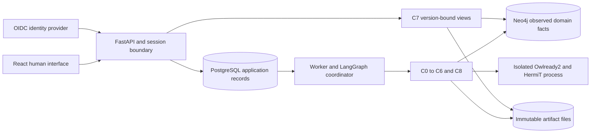

# OaK implementation baseline

Version 0.4.1. November 2, 2026.

The [0.4.2 shared loop and task contract](TASK-CONTRACT.md) supersedes the offer-specific product boundary in this baseline.
One agent can bind multiple task definitions. Offer selection remains an engineering fixture.
The version 0.4.3 [candidate](C06-workspace.md) and [interface](C11-interface.md) contracts define user-proposed edits and protected regression cases.
Apply the [task-binding changes](TASK-CONTRACT.md#component-implementation-work) to the component specifications and requirements graph before implementing shared services.
Read the [current product design](../DESIGN.md) for precedence and current verification status.

This package defines the first product slice and its service boundaries. It extends the [design](../DESIGN.md).
The component documents define proposed behavior. The [local harness](INTEGRATION-HARNESS.md) explains how to run the implemented subset.

The product improves the domain knowledge used by an agent loop. It does not replace the complete agent.
An agent record stores one versioned loop configuration within a project. A run executes that configuration with a pinned kernel.
Start with the [agent shape and compatibility boundary](AGENT-SHAPE.md), its complete JSON declaration, and its derived JSON Schema.
It separates loop profile, task profile, implementation identity, and evidence of runtime compatibility.

Use existing libraries before writing infrastructure. The [shared contracts](CONTRACTS.md#build-versus-reuse) define the reuse decision for each part.
Custom code must implement a domain requirement that the selected libraries do not supply.

## Selected first task

Use task profile `offer-selection-v1` within the managed `sequential_readonly/1` loop profile.
The loop searches offers, obtains missing details, evaluates observed candidates, and returns a supported selection.
Its native tools are `fixture.search_offers` and `fixture.get_offer_details`.
The [existing inputs](../examples/README.md) supply synthetic source records.

The function `select_eligible_offers` checks occupancy, minimum stay, availability, and total price.
Unknown information remains unknown. A search result does not prove eligibility or exhaustive coverage.
The loop cannot reserve accommodation or claim a globally cheapest offer.

The first executable harness uses scripted decisions and deterministic fixtures.
The declaration validators and SQLite substitute check local contracts.
They do not implement the production managed loop or establish a passing server probe.
This is an engineering test population, not a held-out benchmark or evidence of improved model behavior.
Before live comparison, register the provider, model version, enabled thinking configuration, cases, evaluator, and budget.
Do not add a second host adapter before this slice passes its real-service release gates.

## Component map

The original C1 through C5 identities remain unchanged. C0 and C6 through C11 give supporting responsibilities explicit owners.

| Owner | Logic and contract specification | Permitted writes |
| --- | --- | --- |
| C0 | [Task admission](C00-task-admission.md) | Task manifests and admission receipts |
| C1 | [Schema construction and verification](C01-schema.md) | Schema candidates, OWL exports, logical receipts |
| C2 | [Evidence projection](C02-evidence.md) | Observations, domain graph revisions, ingestion receipts |
| C3 | [Function composition](C03-functions.md) | Typed plans, dependency records, function test receipts |
| C4 | [Execution protocol](C04-execution.md) | Tool-call, observation-barrier, and trial records |
| C5 | [Evaluation and repair](C05-evaluation.md) | Independent scores and repair proposals |
| C6 | [Review and activation](C06-workspace.md) | Candidates, review records, atomic active-package pointers |
| C7 | [Read projections](C07-visibility.md) | Read projections only; no server cache in the first slice |
| C8 | [Fixed host loop](C08-agent-loop.md) | Loop checkpoints and decisions |
| C9 | [Identity and project ownership](C09-identity.md) | Users, memberships, projects, agent configurations, sessions |
| C10 | [API and durable coordination](C10-service.md) | Jobs, reservations, events, artifact index, dispatch records |
| C11 | [Human interface](C11-interface.md) | Personal view preferences and submitted commands through C10 |

Component ownership does not require separate deployable services.

## Deployment design

Use a modular Python service and one worker process for the first deployment.
Keep component interfaces explicit within that service. Avoid a separate network service for each component.

| Part | Selected technology | Reason and limit |
| --- | --- | --- |
| API and session boundary | FastAPI, Pydantic, Authlib | One typed HTTP boundary; long work runs in the worker |
| Human interface | React, TypeScript, React Flow, TanStack Query | Generated API types, cached server state, and relation inspection |
| Application records | PostgreSQL 18, SQLAlchemy, Alembic | Relational ownership, standard migrations, activation, audit events |
| Job delivery | Procrastinate | PostgreSQL-backed workers and retry policy; no custom queue |
| Domain facts | Existing Neo4j Community | Parameterized graph access with explicit project and evidence scope |
| Artifacts | SHA-256 addressed local file store | Immutable schema, plans, source payloads, and receipts; project authorization remains mandatory |
| Component scheduling | LangGraph | Persistent construction and inference state, separate from domain relations |
| Schema reasoning | Owlready2 0.51, bundled HermiT, Java 21 | Isolated OWL checks; no completeness, truth, or task-success guarantee |
| Authentication | Keycloak, OIDC authorization code with PKCE, server session | Reuse a provider; do not create a password authentication system |
| Execution evidence | PostgreSQL event index, local JSONL and artifact snapshots | LangSmith export is optional until account configuration is verified |

These are implementation choices. FastAPI distinguishes small background work from computation that needs separate workers.
See its [background-task guidance](https://fastapi.tiangolo.com/tutorial/background-tasks/).
React Flow supports [custom nodes](https://reactflow.dev/learn/customization/custom-nodes); our typed projection supplies their meaning.
Procrastinate supports [connection-bound job deferral](https://procrastinate.readthedocs.io/en/stable/reference.html).
C10 must verify its connector before claiming that metadata and job insertion share a transaction.
Keycloak supplies the [local development identity provider](https://www.keycloak.org/getting-started/getting-started-docker).

The Python root environment remains authoritative. New service and frontend dependencies require lockfiles before service implementation.
No API server, identity provider, PostgreSQL service, or frontend is installed or verified by this document.
The harness uses SQLite to test local contracts. It does not substitute for PostgreSQL or Neo4j acceptance tests.

## One owner for each state

PostgreSQL stores users, sessions, project membership, agent configurations, manifests, jobs, runs, candidates, reviews, and activation history.
Neo4j stores observations and assertions indexed by project, agent, evidence context, projection, and revision.
An ingestion receipt commits with its graph revision inside Neo4j.
PostgreSQL may mirror that receipt for display. A mirror cannot authorize a graph read without the authoritative receipt.

Artifact files store immutable bytes. The database stores their digest, media type, size, scope, and availability state.
Write a temporary file, compute its digest, synchronize it, and rename it into its final location.
Publish its database reference only after those steps succeed.
Missing bytes make the artifact unavailable. An orphan file is eligible for later collection, subject to reference checks.

Do not attempt a transaction across PostgreSQL, Neo4j, and the file store.
Use durable operation IDs, authoritative local receipts, idempotent delivery, and reconciliation.
After a crash, inspect the target store before repeating uncertain work.

The active package pointer is authoritative in PostgreSQL.
A run copies the pointer and all pinned dependency references in its creation transaction.
Activation affects subsequent runs. Existing runs keep their original package and interpretation rules.

## Shared contract rules

`contract_version` is `0.4.0` for this design. The harness has its own narrower version.
Do not infer wire compatibility from similar field names.
The [shared contracts](CONTRACTS.md) govern exact identifiers, artifact references, envelopes, errors, packages, and receipts.
They take precedence over shorter component descriptions of shared types.
Every production message identifies its project, agent when applicable, invocation, attempt, operation, producer, and immutable input references.
Every run message also identifies the run, assignment when applicable, package, and evidence context.

Use UTC RFC 3339 timestamps, opaque IDs, and lowercase SHA-256 digests.
Canonical JSON uses sorted keys, UTF-8, compact separators, and no NaN or infinity.
Use integer minor currency units in the first task. Do not use binary floating-point currency.
Each source adapter declares its conversion and units.

Reject unknown fields at component boundaries. Reject unknown major contract versions before dependent operations.
Treat source text as data. Do not execute source text, model-written Python, model-written Cypher, or browser-submitted query text.

The terminal process states are `succeeded`, `failed`, and `cancelled`.
Domain outcomes and evidence completeness use separate fields.
An empty eligible-offer result can be a successful computation. It can still be an incomplete task outcome.

Every error supplies `code`, `owner`, `stage`, `retryable`, `operation_id`, and affected artifact references.
Record previous attempts and costs. A retry does not reset the deadline or resource ledger.

## Complete schema-change route

1. C5 or a user proposes a patch against an exact base hash.
2. C6 creates an isolated candidate and records the intended requirement change.
3. C1 validates the patch and compiles the supported schema into OWL.
4. C1 runs HermiT and rejects contradictions, unsatisfiable required classes, unsupported encodings, and execution failures.
5. C2 rebuilds the affected projection from preserved source observations.
6. C3 rebuilds affected functions and executes their behavior tests.
7. C4 and C8 replay the declared development regression cases.
8. C5 scores those outcomes with an independent evaluator.
9. C6 binds all required receipts to the candidate hash and exact test inputs.
10. The reviewer inspects the change, regressions, missing coverage, and execution costs.
11. C6 compares the active base and reviewed candidate before atomic activation.

Schema validation and task-driven repair are separate loops in [OaK section 3.2](https://arxiv.org/html/2608.22974v1#S3.SS2).
Our typed compiler, source replay, release gates, auth, and human review extend that algorithm.
Held-out evaluation records defects. It does not modify the frozen kernel.

## Delivery order and release conditions

| Stage | Deliverable | Exit condition |
| --- | --- | --- |
| D0 | Component specifications and local integration harness | Traceable inputs, ownership, failure cases, and passing local harness tests |
| D1 | C9 and C10 service foundation | Real OIDC, authorization, migrations, job recovery, and artifact access tests pass |
| D2 | C0, C1, C2, and C3 | Real HermiT, Neo4j, source replay, and typed function tests pass |
| D3 | C4, C5, C6, and C8 fixed loop | Independent scoring, repair, invalidation, activation races, and restart tests pass |
| D4 | C7 and C11 human interface | Browser journeys, scope isolation, stale views, and accessibility tests pass |
| D5 | Registered fixed-model experiment | Explicit model configuration, population, budgets, controls, and execution authorization exist |

Each failed or unrun gate blocks its dependent release claim.
Real-service tests must cover finalization while observations are pending, cross-store recovery, and task-binding isolation.
The local harness cannot close these gates.

The [requirements graph](../requirements/README.md) holds stable requirement and test IDs.
Keep its statements aligned with the component contracts.
