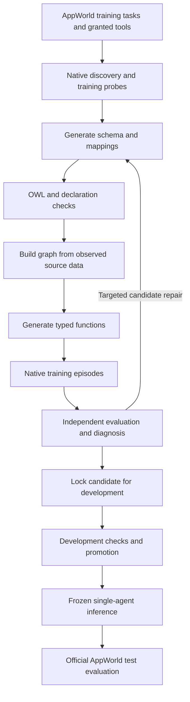

# Ontology runtime PRD set

Status: PRD 1 defines discovery. PRD 2 defines test cases and the initial training flow.
Date: 2026-11-09.

## Purpose

Improve agent reliability by making implicit task relationships explicit.
Start with one ReAct agent and existing Model Context Protocol (MCP) tools.
Do not add an agent memory system.
PRD 1 includes the existing frontend and direct backend model access.
PRD 2 adds trainer-supplied cases, semantic task-success evaluation, incremental graphs, and actual execution traces.
It starts with basic ReAct and constructs an evolving ontology harness from those executions and the discovery proposals.
These product requirements take precedence over older benchmark requirements in this document set.
Users supply product MCP environments and training cases.
The training loop supplies its internal semantic evaluator and runs all saved cases.
PRD 2 includes the implementation sequence based on the reviewed Darwin-Agent/HarnessX source.
Read and write results use one observation path and can both supply graph evidence.
AppWorld is not a prerequisite for the initial training demo.

The [AppWorld plan](07-implementation-plan.md) controls the later benchmark experiment scope.
Components 00 and 03 through 06 retain contracts and superseded benchmark details.
The benchmark sections below remain research proposals. They do not add requirements to the initial product demo.

## Reading order

Read PRD 1 and PRD 2 for the current product flow.
Use the system contract where its invariants agree with that scope.
Read the AppWorld plan for the separate benchmark proposal.

| Document | Contents |
|---|---|
| [00: System contracts and invariants](00-system-contracts.md) | Scope, common terms, 18 invariants, artifact contracts, program bounds, and limits |
| [01: Task surface discovery](01-task-surface-discovery.md) | User inputs, native catalog, tool probes, capability evidence, and initial requirements/schema |
| [02: Test cases and ontology training](02-kernel-construction-training.md) | Case entry, semantic task success, incremental graphs, actual traces, targeted repairs, and fixed inference |
| [03: Evidence and graph](03-evidence-graph.md) | Read receipts, coverage, identity, provenance, graph publication, subgraph selection, and invalidation |
| [04: Inference and tools](04-inference-tool-interface.md) | Single-agent context, native call bindings, result transformation, state, limits, and next-call guidance |
| [05: Action execution](05-action-execution.md) | Intent, conditional commit, source versions, duplicate prevention, unknown outcomes, and confirmation |
| [06: Evaluation and repair](06-evaluation-repair-regression.md) | Data separation, independent scoring, regressions, mutation tests, comparison, metrics, and promotion |
| [07: AppWorld implementation plan](07-implementation-plan.md) | Separate benchmark scope, native integration, evaluation, and component revisions |

## Retained benchmark interaction overview

Training changes the kernel, not model weights.
Use training tasks and their observed trajectories for construction and repair.
Use development tasks for configuration selection and development checks.
Freeze the complete candidate before official test evaluation.
Do not add test failures to the repair corpus.

Inference changes graph evidence and execution state.
It does not change the frozen schema, functions, mappings, or operation contracts.
The model receives a useful typed observation and receipt references after each operation.
The full graph remains in runtime storage.

## Retained benchmark scope

Select a bounded task surface from actual AppWorld training tasks.
Discover its API contracts and observe its tools before schema and function generation.
The catalog can contain the functions that this task surface requires.
Python executes validated compositions of trusted graph operators.
OWL checks supported schema properties.
AppWorld MCP tools perform the application reads and actions.

Compare plain ReAct and ontology-guided ReAct on matched AppWorld tasks.
Use the same model, initial world, grants, and resource limits.
Use the official evaluator for task outcomes and unintended state changes.
See the [official AppWorld documentation](https://github.com/StonyBrookNLP/appworld#bar_chart-evaluating-the-agent).

## Review decisions

Three agents reviewed construction, native execution, and evaluation in the earlier fixture-based draft.
That review did not establish AppWorld compatibility.
The following general concerns remain relevant to the revised scope.

| Review issue | Decision |
|---|---|
| Read markers did not establish actual evidence coverage. | Build accepted graph facts only from validated native responses. |
| An opaque receipt did not help the next decision. | Return typed progress, evidence references, missing dependencies, and next-call options. |
| Tool-and-argument hashes could collide. | Use host invocation IDs and serial dispatch. |
| Current hooks did not prove raw-result replacement. | Make a checked client result boundary an implementation prerequisite. |
| Pre-dispatch freshness checks left a write race. | Use supported provider checks. Do not claim atomicity from a local graph revision. |
| A hidden answer calculation could mask generated function errors. | Keep the oracle in evaluation only. |
| Baseline ReAct could accidentally receive the kernel's semantic checks. | Share physical commit safeguards and report ontology admission as a separate treatment. |
| Subgraph selection could hide missing evidence. | Use dependency read plans and preserve declared scope checks. |
| Discovery and training could count different initial samples. | Record the first sample before the initial schema proposal. |
| A candidate could be called frozen before development passed. | Use `locked_for_development`, then promote the complete version. |

## Explicit implementation limits

The AppWorld integration must establish pagination, identity, action outcomes, and result-format behavior from its actual interfaces.
The graph can contain partial evidence while the agent continues acquisition.
Incomplete coverage must not become a complete result.
Do not transfer the former SQLite version or transaction guarantees to AppWorld APIs.

The earlier hotel and stock experiments do not establish AppWorld performance.
The fixed two-function requirement and generated-world evaluation counts are superseded.
The component drafts require AppWorld-specific revision before implementation.
The earlier experiment's remaining budget does not authorize a new paid experiment.

## Writing reference and review

The writing reference is [ASD-STE100, Issue 9, dated January 15, 2025](https://www.asd-ste100.org/assets/files/ASD-STE100_ISSUE9.pdf).
The official standard contains writing rules and a controlled dictionary.
This document set uses short active sentences and defined project terms.
The review checks terminology, sentence length, paragraph length, links, requirement identifiers, and technical consistency.

Computer terms include schema, compiler, receipt, namespace, transaction, and idempotency key.
The system contract defines their project meanings where necessary.
Computer verbs include compile, decode, serialize, validate, and invalidate.
These verbs describe specific software processes.
Exact application programming interface (API) names, identifiers, and source quotations keep their original spelling.

The review is assisted technical editing against the reference.
It is not an independent certification of full STE compliance.
