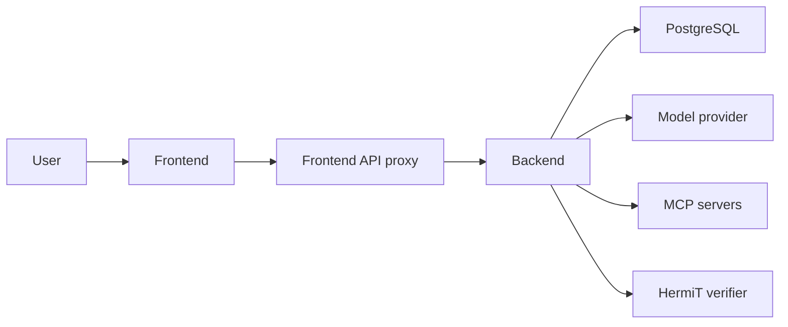

# System guide

[Documentation index](README.md)

## Components

Oak has a Next.js frontend and a Python FastAPI backend.
PostgreSQL stores configuration and execution records.
The backend calls the model and external tools.
The browser does not receive the backend access key.

API means application programming interface.
HTTP means Hypertext Transfer Protocol.
MCP means Model Context Protocol.
HermiT is the formal ontology reasoner.



| Component | Source |
| --- | --- |
| HTTP routes and application lifecycle | [main.py](../backend/oak/main.py) |
| Database access and migrations | [db.py](../backend/oak/db.py), [migrations](../backend/migrations) |
| MCP sessions, catalogs, and authorization | [mcp_client.py](../backend/oak/mcp_client.py) |
| Public endpoint validation | [network.py](../backend/oak/network.py) |
| Model calls and connection checks | [model_client.py](../backend/oak/model_client.py), [model_runtime.py](../backend/oak/model_runtime.py) |
| Discovery and proposal revisions | [discovery.py](../backend/oak/discovery.py), [discovery_modeling.py](../backend/oak/discovery_modeling.py) |
| Saved evidence access | [evidence_access.py](../backend/oak/evidence_access.py) |
| Training orchestration | [training.py](../backend/oak/training.py) |
| Candidate construction | [training_construction.py](../backend/oak/training_construction.py) |
| Task evaluation and repair evidence | [training_evaluation.py](../backend/oak/training_evaluation.py), [training_feedback.py](../backend/oak/training_feedback.py) |
| Agent episode loop | [training_runner.py](../backend/oak/training_runner.py) |
| Request extraction and preservation | [request_preparation.py](../backend/oak/request_preparation.py) |
| Call admission and evidence acquisition | [kernel_dispatcher.py](../backend/oak/kernel_dispatcher.py), [acquisition.py](../backend/oak/acquisition.py) |
| Evidence graph | [evidence_graph.py](../backend/oak/evidence_graph.py) |
| Typed function execution | [kernel_execution.py](../backend/oak/kernel_execution.py), [kernel_values.py](../backend/oak/kernel_values.py) |
| Candidate schemas and targeted patches | [repair_schemas.py](../backend/oak/repair_schemas.py), [repair_patch.py](../backend/oak/repair_patch.py) |
| Standalone repair execution | [repair_executor.py](../backend/oak/repair_executor.py), [repair_workflow.py](../backend/oak/repair_workflow.py) |
| Candidate checks and inference eligibility | [kernel_validation.py](../backend/oak/kernel_validation.py), [kernel_acceptance.py](../backend/oak/kernel_acceptance.py) |
| Formal schema verification | [ontology_verification.py](../backend/oak/ontology_verification.py), [ontology_worker.py](../backend/oak/ontology_worker.py) |
| Interface features | [frontend features](../frontend/src/features) |
| Backend request proxy | [route.ts](../frontend/src/app/api/[...path]/route.ts) |

## Discovery

Discovery saves the task surface, tool grants, and model configuration for the run.
It obtains tool schemas and observations through the granted MCP connections.
The model revises requirements and schema declarations as it obtains evidence.
The runtime keeps the proposals, cited evidence, questions, and call records.

Discovery can propose function needs before executable functions exist.
Training checks existing routes before it adds definitions.
A discovery result is ready only when no blocking gaps remain.

Private credentials returned by discovery tools use references scoped to the run and connection.
The backend resolves those references before dispatch.
The model and evidence views receive references instead of the private values.
Terminal discovery runs remove the temporary credentials.

## Construction and acceptance

The training manager saves the cases, grants, limits, and evaluator version at run start.
It executes every saved case with the basic ReAct loop.
ReAct selects actions and uses their observations for later decisions.
The manager first looks for a compatible accepted candidate for the same agent and task-input digest.
It copies that candidate into the new run for validation.
If no compatible candidate exists, the constructor uses discovery and baseline evidence to make the initial declarations.
The initial declarations need only the schema, mappings, source bindings, and required operation checks.
A successful baseline does not require a new helper function.

Every saved case must have a baseline record.
All saved cases run against the candidate before outcome-based changes can begin.
A successful route remains execution evidence.

The current candidate identifier is `oak.candidate.v3`.
Its declarations include the schema, mappings, request fields, functions, conditions, and operation bindings.
Generated functions compose fixed operators.
The runtime does not execute generated Python or shell code.

The operator library supports these capabilities:

- Typed request extraction.
- Entity lookup, including fuzzy name and text matching.
- Relation traversal and property projection.
- Categorical, connectivity, and numeric filters.
- Set overlap.
- Aggregation, including averages and grouping.

Decimal outputs use typed text.
Action comparisons use exact intermediate values before output rounding.
The formal schema profile permits 100 entities, 300 properties, 200 relations, and 200 axioms.
The maximum supported cardinality is 1000.
The [typed declarations](../backend/oak/repair_schemas.py) define the supported values and plan steps.
The [execution engine](../backend/oak/kernel_execution.py) applies their type checks and execution limits.

These checks are necessary for acceptance:

1. Structural validation of the candidate and its references.
2. Formal schema verification through Web Ontology Language (OWL) and HermiT.
3. Requirement coverage review.
4. Fixed offline cases for permitted calls, rejected calls, and missing evidence.
5. Successful task evaluation for every saved case.
6. Execution coverage for every function and operation binding.

A `RepairReview` records the candidate version, failure evidence, examined definitions, tested routes, and proposed cause.
The runtime checks deterministic validation failures before it requests model diagnosis.
Diagnosis can read saved evidence and execute temporary routes on recorded observations.
Diagnosis cannot call external tools.
A correction must pass the same recorded-input replay that reproduced the defect.
An addition needs a specific missing element, source evidence, and examined alternatives.
A failed route search does not prove that a capability is missing.

Existing routes, agent-use errors, missing evidence, and unresolved causes do not authorize a patch.
The run stops with an explicit reason when no supported change remains.
Duplicate definitions and unsupported persistent constants are rejected.
An identical rejected proposal remains blocked when its definitions and evidence have not changed.
Sample values must be parameters unless the original task or tool contract fixes them.

Targeted repairs change candidate declarations.
They do not change the evaluator, task boundaries, tool grants, or operator implementations.
The runtime keeps earlier candidate versions and their decisions.

The semantic evaluator returns `passed`, `failed`, `inconclusive`, or `error`.
It must cite saved evidence for a pass or failure.
An incomplete episode or missing decisive evidence cannot establish task success.

## Why the nine operator capabilities matter

An operator performs one defined operation on typed inputs.
The project adopts the nine public capabilities in Appendix B of the [source paper](paper/source/oak-2608.22974v1.pdf).
The explanations below give the project rationale for that choice.
They describe expected benefits, not measured reliability gains for this implementation.

These capabilities cover recurring steps in the tested task flows.
The set contains one request capability, three evidence capabilities, four condition capabilities, and one aggregation capability.
They convert a request into explicit values, locate relevant evidence, follow relations, apply conditions, and calculate results.
Their names and contracts remain stable across task domains.
A task supplies its entity types, relations, conditions, and parameter values.
The runtime supplies the operator implementations.

### What each capability provides

| Capability from the paper | Purpose | Benefit for the agent and harness |
| --- | --- | --- |
| Runtime-slot extraction, `extract_runtime_slots` | Convert the original request into declared typed values with source evidence. | Make dates, quantities, identities, and exclusions available for later checks. In this project, request preparation checks preservation of the original meaning. |
| Entity lookup, `lookup_entities` | Find entities by type, identity, properties, name, or text. | Select relevant records from the graph. Identity and source references remain available. A fuzzy match alone cannot establish exact identity. |
| Relation traversal, `traverse_relations` | Follow declared relations from selected entities within a hop limit. | Reach related policies, accounts, or source records. A route through several relations can answer a query without a new saved function. |
| Property projection, `project_properties` | Select named properties from the resulting entities. | Supply the fields needed by the next operation. The runtime keeps source identities, scope, and evidence references with the selected values. |
| Categorical filtering, `filter_property_categorical` | Apply inclusion or exclusion conditions to categorical values. | Express conditions such as a required record type or permitted status. The agent can apply the same condition to each observed record. |
| Relation-connectivity filtering, `filter_relation_connected` | Keep entities connected to specified entities through required relations. | Distinguish a record with a valid value from a record with the required relationship. For example, an offer must belong to the requested supplier. |
| Numeric filtering, `filter_numeric` | Apply numeric comparisons, thresholds, or intervals. | Express conditions such as sufficient capacity, an acceptable cost, or a permitted stay length. Typed operands and unit checks support consistent comparisons. |
| Set-overlap filtering, `filter_set_overlap` | Compare a property containing several values with the requested set. | Distinguish any required feature, all required features, and a minimum number of matching features. Duplicate values do not increase the match count. |
| Aggregation, `aggregate_values` | Calculate counts, totals, minima, maxima, or averages, with optional groups. | Calculate results across records with explicit scope and units. The runtime requires sufficient coverage before it reports a complete population result. |

Traversal and connectivity filtering have different results.
Traversal returns the entities and relations reached from a starting point.
Connectivity filtering retains input entities that have a required connection.
For example, traversal can retrieve an offer's supplier.
Connectivity filtering can retain offers associated with one specified supplier.

The four filter capabilities also express different conditions.
A category, a relation, a numeric threshold, and a set of features have different comparison rules.
Explicit predicates preserve those differences when the agent builds a plan.

### Why use this set

The set provides reusable operations for explicit task relationships.
The same lookup, traversal, and comparison operations can support bookings, orders, or inventory tasks.
Domain knowledge stays in the schema, relations, source mappings, and declared conditions.
The operator code does not need a separate implementation for each domain.

The operations can supply inputs to later operations.
A lookup can supply starting entities for traversal.
Projection can supply values for aggregation.
A saved function result can supply a parameter for a later graph query.
This composition supports new queries without a new function for every question.

The fixed contracts also give the runtime specific checks to perform.
It can reject an unknown relation, incompatible value type, unsupported unit conversion, or excessive traversal.
Results retain evidence references, scope, and missing-data status.
These records help diagnosis distinguish an execution defect from unavailable observations.
They do not establish the cause of every task failure automatically.

The paper's count describes its public library.
We have not established that nine is a minimum or complete set for every possible task.
This project uses the paper and current requirements as the basis for the library.
A task uses only the capabilities it needs.
A missing shortcut does not establish a need for another operator or saved function.

### Connection to the pre-call check

Suppose the user requests a two-night stay.
Request preparation records that value.
Lookup selects an offer, and traversal obtains its observed booking policy.
A numeric condition compares the requested stay with the policy's minimum stay.
Filtering can remove offers that do not satisfy that condition.

Before booking, the operation's decision function checks the exact selected offer and proposed arguments.
An `assert` step evaluates the required minimum-stay condition.
A `decision` step combines the required check results.
A failed condition blocks the booking call.
Missing policy evidence produces a missing-evidence result.
Filtering a list does not satisfy this mandatory action check.

The agent still selects its next step.
The harness makes relevant conditions executable and supplies evidence for that choice.
Acceptance tests and matched baseline comparisons must establish whether the resulting behavior improves.

### Mapping to the current implementation

The nine paper capabilities do not correspond to nine plan-step names in this repository.
[Request preparation](../backend/oak/request_preparation.py) implements runtime-slot extraction outside the graph plan.
It uses model-based extraction and a separate preservation check.
The graph executor implements the data operations with fixed code.
The four filtering capabilities use a shared `filter` step with different predicate types.

The [typed plan grammar](../backend/oak/repair_schemas.py) contains eleven step names:
`input`, `lookup`, `traverse`, `select_types`, `filter`, `project`, `aggregate`, `select_group`, `select_min`, `assert`, and `decision`.
`select_types`, `select_group`, and `select_min` support type selection, group selection, and ordered record selection.
`input`, `assert`, and `decision` support operation checks.

[Graph queries](../backend/oak/graph_query.py) permit the eight data steps.
They exclude `input`, `assert`, and `decision`.
A temporary graph query cannot authorize or dispatch an external action.
The dispatcher runs the declared operation checks before an external call.

## Graph access and records

`run_function` takes a saved function ID and `arguments_json`.
The runtime validates the arguments before execution.
Decision functions remain internal operation checks.
`query_graph` takes `query_json`, which must conform to the published `GraphQuery` schema.
The query uses the existing lookup, traversal, filtering, projection, and aggregation operators.
It cannot dispatch actions, grant access, or change definitions.
Each traversal permits at most four hops.
All other execution, evidence, scope, completeness, and unit checks still apply.

Request preparation permits an empty function selection.
A query can use saved functions, temporary graph routes, or both.
A validated graph query supplies evidence needs to the existing acquisition checks.
All external calls still require granted tools, valid arguments, source access, and operation checks.

The model receives a short catalog index.
`read_evidence` provides complete definitions and the query schema from `harness_catalog`.
**Definition catalog** and **Change history** use saved candidates and training events.
They show versions, dependencies, supporting evidence, recorded use, reviews, routes, and rejected changes.
Earlier records that lack a repair review have an explicit label.
No separate registry or database migration is required.

## Technical walkthroughs

These twelve walkthroughs follow the engineering areas in the opening README.
Each example identifies its input, execution steps, result, and boundary behavior.
The examples use separate controlled fixtures. They are not one continuous production run.
The [test map](tests.md#mechanism-test-map) gives the repeat commands and supporting tests.
The [boundary table](#operating-boundaries-and-failure-points) records the execution limits.

| Area | Walkthrough |
| --- | --- |
| Task and tool boundaries | [1. Check tool access](#1-check-tool-access) |
| Request meaning | [2. Preserve the request](#2-preserve-the-request) |
| Live graph updates | [3. Keep observations in their scope](#3-keep-observations-in-their-scope) |
| Executable definitions | [4. Execute typed comparisons](#4-execute-typed-comparisons) |
| Missing observations | [5. Obtain complete evidence](#5-obtain-complete-evidence) |
| External actions | [6. Check each booking call](#6-check-each-booking-call) |
| Reuse before additions | [7. Query without a new function](#7-query-without-a-new-function) |
| Failure diagnosis | [8. Reproduce a defect before repair](#8-reproduce-a-defect-before-repair) |
| Controlled changes | [9. Check persistent additions](#9-check-persistent-additions) |
| Acceptance | [10. Require every saved case](#10-require-every-saved-case) |
| Resource limits | [11. Read large evidence within limits](#11-read-large-evidence-within-limits) |
| Versions and visibility | [12. Inspect an accepted version](#12-inspect-an-accepted-version) |

### 1. Check tool access

Input: the booking fixture defines `catalog.search` and `catalog.create`.
Each episode receives its selected tools within the agent's grants.
The fixture uses controlled transport, which records calls.

1. Supply `catalog.search` with its unchanged tool definition and valid request arguments.
2. Check the tool identifier and definition against the episode's selected tools.
3. Validate the arguments against the declared input schema.
4. Execute the operation's bound checks.
5. Save the dispatch decision before transport.
6. Dispatch only an allowed invocation with its matching permit.

The valid search reaches transport once.
The following variations use separate fixture instances:

| Variation | Result |
| --- | --- |
| Use a tool outside the selected set | Reject the call before transport. |
| Replace the selected tool's input schema with an empty schema | Reject the changed definition. |
| Supply `guests: "3"`, `guests: true`, or `guests: null` | Reject the invalid integer argument. |
| Remove search access, then attempt a booking without evidence | Return missing evidence without suggesting the unavailable search tool. |
| Fail to persist the dispatch decision | Do not call transport. |

Boundary: a grant permits access to an operation. It does not prove that a provider's response is correct.
The application relies on the provider to enforce its own service permissions.
Evidence: [dispatcher tests](../backend/tests/test_kernel_dispatcher.py) and the ungranted-tool check in [query tests](../backend/tests/test_graph_query.py).

### 2. Preserve the request

Input: request three guests, dates `2027-01-10` through `2027-01-12`, and a maximum cost of 30000 USD cents.
Add the instruction, "Do not change the party to 1 guest."
The fixture's first extraction incorrectly returns `guests: 1`.

1. Extract the declared fields from the original query and task boundaries.
2. Validate each field's type and cited source text.
3. Compare the extraction with the whole original request through the preservation check.
4. Return `needs_correction` for the incorrect party size.
5. Repeat extraction and preservation once with that correction record.
6. Save a ready request containing `guests: 3` and the original dates and budget.

The fixture records two attempts and four model calls.
No tool observation supplies request authority.

| Variation | Result |
| --- | --- |
| Both attempts leave an unresolved condition without named fields | Return `unresolved_request`. |
| A condition cannot be represented by the accepted harness | Return `unsupported_request` without a correction attempt. |
| Only the budget remains unresolved | Remove its usable value. Block operations that depend on the budget. Independent evidence reads can continue. |
| A cited quotation does not occur in the original sources | Reject the extraction. |

Boundary: the type and quotation checks are deterministic. The extraction and preservation decisions still depend on model judgments.
Two agreeing judgments can share the same semantic error.
Evidence: [request preparation tests](../backend/tests/test_request_preparation.py).

### 3. Keep observations in their scope

Input: the graph fixture declares a `record` entity with identity field `id` and scope field `city`.
Observation `a` supplies `id: "same", amount: 7` for city `A`.
Observation `b` supplies `id: "same", amount: 20` for city `B`.

1. Validate each observation against its mapping and argument-derived scope.
2. Add the records under their respective identities and scopes.
3. Look up `record` with `id: "same"` and `city: "A"`.
4. Return amount `7` with references to observation `a`.
5. Look up the same identifier in city `B`.
6. Return amount `20` with references to observation `b`.

An exact observed record can be complete while the full collection remains incomplete.
City `C` cannot reuse either record as evidence for its own scope.

| Update variation | Result |
| --- | --- |
| A replacement record omits `amount` | Invalidate the earlier amount and retain its history. |
| A declared partial update omits `amount` | Keep the earlier amount and its original evidence reference. |
| A coverage flag is the string `"true"` instead of a Boolean | Reject the update without publishing its otherwise valid rows. |
| A mapping fails halfway through an observation | Preserve the previous graph snapshot. |

Boundary: mapping validation checks declared structure. It cannot establish the truth or freshness of correctly typed provider data.
Evidence: [scoped graph tests](../backend/tests/test_scoped_evidence_graph.py).

### 4. Execute typed comparisons

Input: an observed offer costs `24000` in `USD.cent`.
A request supplies a budget of `300` in `USD`.
The fixture declares an explicit conversion before comparison:

```json
{"kind": "convert", "value": {"kind": "request", "name": "budget"}, "unit": "USD.cent"}
```

1. Validate the expression's declared input and result types.
2. Convert the request budget to `30000 USD.cent`.
3. Compare the observed `24000 USD.cent` cost with that budget.
4. Return an allowed decision when all required conditions pass.
5. Repeat with a budget of `200 USD`.
6. Return a rejected decision because the cost exceeds `20000 USD.cent`.

| Boundary case | Result |
| --- | --- |
| Compare different units without a supported conversion | Reject the definition during validation. |
| Convert `24001 USD.cent` to an integer number of `USD` | Report an execution error instead of rounding away the fraction. |
| Submit an unsupported formal axiom | Reject the schema under the supported profile. |
| The formal verifier cannot start or exceeds its deadline | Record an infrastructure failure. Do not treat it as evidence for a declaration repair. |

Plans contain at most 100 steps. Each traversal permits at most four hops.
The runtime supplies operator implementations. Generated declarations cannot introduce executable Python or shell code.
Formal consistency does not prove that a domain condition is correct or sufficient.
Evidence: [typed execution tests](../backend/tests/test_kernel_execution.py), [formal tests](../backend/tests/test_ontology_verification.py), and [training validation](../backend/tests/test_training_validation_flow.py).

### 5. Obtain complete evidence

Input: the acquisition fixture requests customer `C17` and a total cost over qualifying offers.
Its source contract declares customer and date filters, required fields, and pagination.
The first page contains one offer costing `12000 USD.cent` and a next-page cursor.

1. Derive the required identity, capacity, and cost fields from the validated query or function.
2. Check the proposed source arguments against the request's customer, party, and dates.
3. Require the declared fields `id`, `capacity`, and `total_cost`.
4. Dispatch the permitted first-page request and ingest its response.
5. Keep the total incomplete while another page remains.
6. Request the recorded next cursor and ingest the second offer costing `12000 USD.cent`.
7. Return `24000 USD.cent` when the final page establishes complete coverage.

The result retains references to both page observations.
A response-level completeness flag cannot override an unfinished declared page sequence.

| Variation | Result |
| --- | --- |
| Change the requested customer to `C99` | Reject the source arguments before transport. |
| Omit a required projected field or add an undeclared argument | Reject the acquisition request. |
| Repeat a cursor or return conflicting records across pages | Reject ingestion without changing the previous graph. |
| Supply complete records from another customer scope | Keep the current customer's need unresolved. |

Boundary: missing observations do not authorize schema growth.
Completeness does not establish freshness. A valid repeated data call requests a new observation.
The acquisition result records `mode: "refresh"` when the required evidence was already complete.
The call keeps the same grants, source restrictions, operation checks, and run budget.

For a paged refresh:

1. Complete the current page sequence.
2. Request the source's declared initial cursor again.
3. Start a new page population when the first valid response arrives.
4. Mark its coverage incomplete until the last page arrives.
5. Calculate totals only from that new population.

The refresh fixture changes a complete total from `24000` to `27000 USD.cent`.
It preserves the earlier observations as history and excludes their old population from the new total.
A failed ingestion preserves the previous graph atomically.
Training can help the agent learn when a new observation is necessary.
The runtime has no universal expiry time and does not guarantee that the model will request every necessary refresh.
Evidence: [acquisition tests](../backend/tests/test_acquisition.py) and [query acquisition tests](../backend/tests/test_graph_query.py).

### 6. Check each booking call

Input: the booking fixture requests three guests, the stated dates, and a budget of `30000 USD.cent`.
Its operation binding requires `check_parameters` and `check_offer`.
Its controlled transport records calls and returns a test booking identifier.

1. Propose a booking for `offer-a` before observing the offer.
2. Return `missing_evidence` and the permitted source without dispatching the booking.
3. Add an observation with capacity `4` and cost `24000 USD.cent` in the request's scope.
4. Propose the same booking with the original party and dates.
5. Execute both bound functions automatically and save their results.
6. Dispatch the call with a permit for that tool, argument digest, and invocation identifier.

The saved decision also identifies the candidate, request, and graph revision.
The agent cannot skip these checks by omitting a `run_function` call.

| Variation | Result |
| --- | --- |
| A new observation raises the offer's cost to `40000 USD.cent` | Reject the next booking against graph revision 2. |
| Change the proposed party to one guest | Reject the false `party_match` condition. |
| Apply an earlier allowing decision to unobserved `offer-b` | Return missing evidence for that offer. |
| Reuse the permit with different arguments or another invocation | Reject the permit. |
| The external action outcome becomes unknown | Stop the run without automatic retry or replay. |

Boundary: the revised-price booking fixture supplies the new observation directly.
Separate agent-loop tests execute permitted refresh calls through acquisition and use their new facts.
Local call checks do not lock external inventory, guarantee exactly-once execution, or reverse completed writes.
Evidence: [dispatcher tests](../backend/tests/test_kernel_dispatcher.py) and [training action tests](../backend/tests/test_training.py).

### 7. Query without a new function

Input: the graph-query fixture contains two observed suppliers and an existing `supplier` entity definition.
The `query_json` tool argument contains this JSON as a string:

```json
{
  "steps": [
    {"op": "lookup", "id": "rows", "entity_id": "supplier"},
    {
      "op": "project", "id": "result", "input": "rows",
      "fields": [
        {"name": "id", "expression": {"kind": "field", "name": "id"}},
        {"name": "name", "expression": {"kind": "field", "name": "name"}}
      ]
    }
  ],
  "return_step": "result",
  "output": {
    "kind": "rows",
    "fields": [
      {"name": "id", "type": "string"},
      {"name": "name", "type": "string"}
    ]
  }
}
```

1. Read the existing definitions and query schema from `harness_catalog`.
2. Validate the supplied plan as a `GraphQuery`.
3. Execute its temporary function through the fixed graph engine.
4. Return `[{"id":"s1","name":"Acme"},{"id":"s2","name":"Other"}]` with source references and complete coverage for this fixture.
5. Compare the candidate digest before and after execution.
6. Confirm that the digest and saved function library remain unchanged.

Related fixtures follow three or four relations and retain the same candidate digest.
Another fixture uses a saved function's supplier identifier as a later graph-query argument.

| Boundary case | Result |
| --- | --- |
| Request `max_hops: 5` in one traversal | Reject the plan. Several bounded traversals remain possible within plan limits. |
| Add schema declarations or an action or decision step to the query | Reject the query schema. |
| Query before the necessary observations exist | Return incomplete evidence and acquisition needs. |
| Reuse a saved function with a different record argument | Keep a separate argument binding for each call. Preserve values fixed by the original request. |

The reuse fixture calls one `total` function for `C17`, then `C99`, then `C17` after a refresh.
It returns `12000`, `23000`, and `33000 USD.cent`, respectively.
The original request fixes the party size at three. Changing that value is rejected.
Each customer's source call uses its own binding. The later call does not replace an earlier binding.
A failed route search does not prove that a capability is missing.
Evidence: [query tests](../backend/tests/test_graph_query.py).

### 8. Reproduce a defect before repair

Input: a saved observation contains `id: "s1"` and `name: "Acme"`.
The faulty candidate maps the supplier's `name` property from `/id`.

1. Execute the supplier query on the recorded observation.
2. Record the incorrect result `{"id":"s1","name":"s1"}`.
3. Read the expected supplier name from the same source observation.
4. Record a review targeting `mappings/suppliers`, with the source, query, candidate digest, and proposed cause.
5. Replace that property's source path with `/name`.
6. Repeat the query on the same observation and confirm `{"id":"s1","name":"Acme"}`.
7. Submit the corrected candidate to validation and all saved cases before acceptance.

Diagnosis makes no external calls.
The correction fixture rejects an unrelated edit and a review whose underlying evidence has changed.

| Review variation | Permitted outcome |
| --- | --- |
| Remove the supplier mapping entirely, with source evidence for its fields | Permit the supported mapping addition and require its replay to pass. |
| Observe a tool failure, context limit, or evaluator error | Keep the definitions unchanged. |
| Identify an existing route or agent misuse | Record the available capability without an automatic patch. |
| Fail to identify a supported cause | Finish unresolved. |

Boundary: replay checks the recorded inputs. It does not prove a universal cause or an exhaustive search of alternatives.
The current missing-definition review rejects function additions, including new helper functions.
Evidence: [repair review tests](../backend/tests/test_repair_review.py).

### 9. Check persistent additions

Input: a valid candidate contains an existing function.
The first proposal copies that function under the identifier `another_name`.

1. Remove the definition identifier from the comparison representation.
2. Normalize internal plan-step identifiers and references.
3. Compare the normalized content with definitions in the same collection.
4. Reject the exact duplicate under its new identifier.
5. Record the rejected proposal with its candidate and evidence digest.

Every persistent constant use then requires a separate semantic decision:

1. List the value with its definition identifier and exact path.
2. Give the fixed coverage evaluator the original contracts and the whole definition.
3. Require one decision for every listed use, including values retained from an earlier candidate.
4. Use `fixed` only when an original contract fixes that value for that specific use across requests.
5. Require a valid source reference under the original task, agent, or native tool contract.
6. Reject acceptance if any use requires a parameter, lacks support, or has no decision.

The existing coverage call performs this review. No additional evaluator call is required.
Two fixtures also exercise constants and repeated proposals:

| Proposal | Result |
| --- | --- |
| Persist `customer-17` from a sample query only | A sample cannot supply the required original-contract reference. Keep the value as a parameter. |
| Persist that value when the original task explicitly fixes it | Require a `fixed` decision for its exact use and record the task-source reference. |
| Repeat the same rejected changes against unchanged definitions and evidence | Reject the repeated proposal. Changing run identifiers does not make it new. |
| Change the underlying observed evidence | Produce a different proposal key for review. |

Boundary: the duplicate check compares normalized content. It does not establish semantic equivalence between different plans.
The negative fixture uses the instruction, "Do not restrict results to customer-17 or any other single customer."
It supplies a `parameter` or `unsupported` evaluator decision for that constant use.
The runtime rejects acceptance even if the evaluator's overall coverage result says `passed`.
An omitted decision produces an inconclusive report. A text occurrence alone cannot supply approval.
Boundary: the semantic decision still uses a model. Incorrect meaning judgments remain possible and need suitable negative cases.
Evidence: [definition and proposal tests](../backend/tests/test_repair_review.py) and [training rejection tests](../backend/tests/test_training_validation_flow.py).

### 10. Require every saved case

Input: the integration fixture supplies two saved note tasks and a prepared environment identified as `fixture:notes:v1`.
The accepted result contains four episodes: two baseline episodes and two harness episodes.

1. Save the cases, tool selection, limits, and evaluator version for the run.
2. Execute each case through basic ReAct in prepared conditions.
3. Construct or reuse a candidate and run structural, formal, coverage, and fixed offline checks.
4. Execute both cases with the candidate in comparable conditions.
5. Require a passing task evaluation for each case.
6. Require successful execution coverage for every retained function and operation binding.
7. Save acceptance only when all required checks pass.

| Variation | Result |
| --- | --- |
| A task result is `failed`, `inconclusive`, or `error` | Do not accept the candidate. |
| Task results pass, but an operation binding has no successful execution | Reject the candidate with the missing coverage. |
| A repair improves one case but breaks another | The broken case prevents acceptance. |
| A repeated episode has no prepared or declared stable environment | Block it before external dispatch. |

A completed run and an accepted candidate have different meanings.
Inference uses the accepted definitions with a new graph and does not execute the training evaluator.
Boundary: finite saved cases do not establish generalization.
A trainer declaration of stable state is an assertion. It does not reset a provider.
Evidence: [training integration tests](../backend/tests/test_training.py) and [validation-flow tests](../backend/tests/test_training_validation_flow.py).

### 11. Read large evidence within limits

Input: the evidence fixture stores 1000 records. Each record has an identifier and a 500-character body.
The requested fact is the last record.

1. Save the complete observation as `observation-1`.
2. Create a bounded view and mark omitted content explicitly.
3. Read `{"id":"observation-1","path":"/items/999"}` through `read_evidence`.
4. Return the exact saved record with identifier `999`.
5. Confirm that the complete stored observation remains unchanged.

The default view budget is 4096 serialized UTF-8 bytes, used as a conservative token bound.
The model client also counts the full model input before generation.
The view does not summarize or semantically compact the observation.

| Boundary case | Result |
| --- | --- |
| Read an unavailable record or a record from another run | Return unavailable evidence. Do not dispatch an external call. |
| Replace an existing evidence record under the same identifier | Reject the replacement. |
| Mandatory request context cannot fit | Raise `ContextCapacity` and record the stop. |
| A task evaluator has not read decisive evidence | Keep its result inconclusive. |
| The run cannot reserve the next call within its model budget | Stop before dispatching that call. |

Boundary: keeping evidence does not guarantee that the model reads or understands it.
A valid task can exceed the available context, time, or cost budget.
Evidence: [evidence tests](../backend/tests/test_evidence_access.py), [model tests](../backend/tests/test_model_runtime.py), and [run-budget tests](../backend/tests/test_training.py).

### 12. Inspect an accepted version

Input: an accepted candidate record identifies its task-input digest, declaration digest, runtime versions, and validation events.
The eligibility fixture provides matching formal, coverage, and fixed offline reports.

1. Check the candidate's accepted status and current task-input digest.
2. Recompute the declaration digest and check current tool grants.
3. Check the runtime version manifest and referenced validation reports.
4. Enable inference only for the accepted operation bindings.
5. Open the training result's Definition catalog and Change history.
6. Expand a definition, follow its evidence link, and reload the page.
7. Confirm that the same candidate digest and repair review remain visible.

The browser fixture also labels the model explanation as a proposed cause.
The following variations demonstrate separate boundaries:

| Variation | Result |
| --- | --- |
| Change a runtime version or remove a required grant | Disable inference. |
| Change declarations without updating the accepted record | Reject the digest mismatch. |
| Remove or alter a required validation report | Disable inference. |
| Load earlier history without a repair review | Show the missing-review notice. Do not invent a review. |
| Reload a stopped run | Keep it stopped without resuming external calls. |

Boundary: the interface makes recorded evidence inspectable. It does not independently prove the correctness of a model explanation.
The eligibility gate relies on training to set accepted status after successful case execution.
Evidence: [acceptance tests](../backend/tests/test_kernel_acceptance.py) and [training browser tests](../frontend/e2e/training.spec.ts).

## Operating boundaries and failure points

An enforced boundary can stop an unsafe or unsupported execution.
A remaining failure point can still cause an incorrect or incomplete task result.
The table distinguishes these outcomes for the twelve engineering areas.

| Area | Enforced boundary or stop behavior | Remaining failure point |
| --- | --- | --- |
| Task and tool boundaries | Reject ungranted tools, changed tool definitions, and invalid arguments before transport. | A permitted provider can return incorrect data. A grant does not prove that every permitted action is appropriate. |
| Request meaning | Validate types and source quotations. Permit one extraction correction. Block unsupported requests or operations that depend on unresolved values. | Extraction and preservation use model judgments. Both can miss the same meaning or condition. |
| Live graph updates | Keep identity and evidence scope. Reject invalid updates atomically. Require declared coverage before treating a collection as complete. | Correctly typed data can still be wrong. A local revision cannot prove freshness or a consistent state across providers. |
| Executable definitions | Enforce the plan grammar, type and unit rules, supported OWL profile, and execution bounds. | Logical consistency does not prove domain correctness. Unsupported computations require a different agreed implementation. |
| Missing observations | Check source filters, field selection, and page cursors for acquisition and refresh. Keep refresh populations separate. | A source can be unavailable. The model can omit a necessary refresh, and the provider can return stale data. |
| External actions | Check exact arguments before each call. Stop on unknown outcomes without automatic replay. | A provider can complete a write before a connection fails. Oak cannot infer that outcome or undo the write by stopping. |
| Reuse before additions | Keep request-fixed arguments and separate call bindings. Temporary queries cannot change definitions or authorize actions. | The model can miss a valid route within its search budget. |
| Failure diagnosis | Check cited evidence and replay results. Limit patches to reviewed targets. Diagnosis cannot call external tools. | Replay covers recorded inputs. It cannot prove that the proposed cause explains every failure. Missing-definition reviews currently reject new helper functions. |
| Controlled changes | Compare normalized definitions. Require a complete constant-use review with original sources. Reject unchanged rejected proposals. | Duplicate detection does not prove semantic equivalence. Constant meaning still depends on the fixed evaluator. |
| Acceptance | Require validation, execution coverage, and every saved case to pass. Require comparable conditions for repeated training. | Finite cases do not establish generalization. A trainer declaration of stable state does not itself reset an external service. |
| Resource limits | Bound calls, tokens, cost, time, graph operations, and evidence views. Record a stop when required context cannot fit. | A valid task can exceed the limits. Evidence storage does not guarantee that the model reads the decisive fact. Automatic semantic compaction is absent. |
| Versions and visibility | Reject incompatible acceptance records. Preserve versions and show reviews, routes, and evidence links. | Earlier records can lack reviews. An inspectable history does not establish that a proposed cause is correct. The interface still needs improvement. |

The formal verifier checks schema declarations. It does not verify the truth of each external observation or the model's final answer.
Inference does not run the training evaluator.
The current tests establish controlled behavior within their fixtures.
The [evaluation limits](tests.md#live-model-evaluation) describe the incomplete live demonstration and comparison.

## Inference

For inference, the candidate must have accepted status and current inputs and runtime versions.
The acceptance record must identify matching formal, coverage, and offline validation reports.
The backend also validates the candidate digest and current tool grants.

The runtime extracts the original query into declared request fields.
It validates preservation of the query before tool execution.
One dispatcher evaluates each proposed read or write against the fixed request and exact arguments.
It executes necessary bound functions even when the model does not call those functions directly.

Missing facts cause a denied call with its evidence needs.
The acquisition component connects those needs to declared native source arguments.
It validates filters, field selections, and page cursors before transport.
An existing fact can satisfy a need only in the applicable graph scope.

Inference starts a new evidence graph.
It does not change the accepted definitions or execute the training evaluator.
The result thus contains execution evidence, not an independent inference success grade.

## Evidence and context

Read responses and write responses use the same observation path.
Each response type can supply graph facts.
Each fact keeps references to its actual source observation.
Failed and unknown calls remain records of attempted execution.

The graph preserves missing data, conflicts, scope, and coverage information.
A partial page does not establish a total or the absence of other records.
Repeated cursors and conflicting page records stop ingestion.
A local graph revision does not prove a consistent external snapshot across providers.

Complete observations remain in run storage.
The internal `read_evidence` operation reads those records through bounded views.
It supports JSON Pointers, array ranges, text ranges, and text search.
It cannot execute external tools.
Baseline and harness episodes use the same evidence reader.

Each evidence view has a default budget of 4,096 serialized UTF-8 bytes.
The reader uses this size as a conservative token bound.
The context policy targets 80% of the input budget.
The model client counts instructions, tool definitions, and output schemas before generation.
Necessary context that exceeds capacity stops the run with a recorded reason.

## Storage

The migrations define the existing database structure.

| Migration | Stored information |
| --- | --- |
| [001](../backend/migrations/001_onboarding.sql) | Tasks, members, agents, connections, tools, and grants |
| [002](../backend/migrations/002_task_scope.sql) | Task scope |
| [003](../backend/migrations/003_agent_scope.sql) | Agent scope |
| [004](../backend/migrations/004_model_runtime.sql) | Model connection checks and cost records |
| [005](../backend/migrations/005_discovery.sql) | Tool output schemas, discovery calls, artifacts, questions, and events |
| [006](../backend/migrations/006_discovery_credentials.sql) | Temporary discovery credential references |
| [007](../backend/migrations/007_training.sql) | Training cases, runs, candidates, episodes, calls, and events |

Local development encrypts credentials with a Fernet key.
Production uses Supabase Vault.
Production startup rejects local secret storage and local MCP access.

## Access and interruption

The private preview uses a shared HTTP Basic access gate.
Its demo user selector is not a production identity system.
The backend validates a separate API key and evaluates task membership for task routes.
Agent grants cannot include tools from another task.

The application supports Streamable HTTP MCP endpoints.
It supports public access, bearer tokens, and OAuth through the software development kit (SDK).
The initial product does not launch local command-based MCP servers.

The deployment uses one backend worker.
After interrupted authorization, a new connection attempt is necessary.
Interrupted calls remain recorded without automatic replay.
Stopping a run does not reverse external actions.
