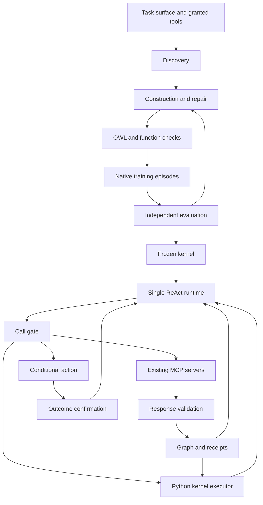

# PRD 00: System contracts and invariants

[Product documentation](../../docs/README.md) | [Current system guide](../../docs/system.md)

This document retains component contracts and earlier research proposals.
Apply the current product scope before its benchmark-specific requirements.
Use the current system guide for implemented behavior.

Status: Retained component draft. AppWorld is the proposed benchmark environment.

Product scope update, 2026-11-08: [PRD 1](01-task-surface-discovery.md) controls discovery.
It uses the existing frontend, direct backend Gemini access, and user-supplied MCP environments.
Training examples and an evaluator are not discovery prerequisites.
The older frontend and CLI restrictions below apply only to the retained benchmark draft.

## AppWorld scope revision

The [AppWorld implementation plan](07-implementation-plan.md) controls the proposed benchmark scope.
Retain this document's generic invariants and component responsibilities.
The hotel and stock profiles, fixed two-function catalog, and fixture-specific acceptance counts are superseded.
SQLite source templates and reservation transactions are not AppWorld requirements.
Do not assume global source versions, complete collection reads, or provider idempotency.
Revise these details against the actual AppWorld interface before implementation.
Use official AppWorld splits and evaluation instead of the former generated-world protocol.
This component draft is not yet an implementation-ready AppWorld specification.

## 1. Purpose

Improve agent reliability by making implicit task relationships explicit.
The system constructs a task-specific ontology kernel.
The kernel defines the facts and computations that support an agent decision.
The runtime checks calls and records their evidence.

A product requirements document (PRD) defines required behavior and acceptance conditions.
An invariant is a condition that the system must preserve for every supported task surface.
A task surface defines the requests, evidence, operations, and outcomes that one agent can support.

## 2. Scope

**SYS-001.** Run one ReAct agent during each episode.
ReAct is the repeated selection of an operation, execution of that operation, and inspection of its result.
Construction can use separate model calls for generation and diagnosis.
These calls do not add autonomous agents to product inference.

**SYS-002.** Use existing Model Context Protocol (MCP) servers for external operations.
Do not create an MCP server for this implementation.
The first implementation uses the existing SQLite and Filesystem servers.
Execute ontology functions in the trusted Python runtime.
Register their typed interfaces as internal kernel function tools in the agent client.
These functions do not grant access to additional external services.

**SYS-003.** Do not add an agent memory system.
Each episode starts without conversation content from previous episodes.
The current conversation, graph, receipts, and action state are execution state.
Retained test records support construction and audit only.
Inference does not retrieve previous conversations or successful trajectories as memory.

**SYS-004.** Use Gemini through its command-line interface (CLI) for planned native model runs.
Keep the transport adapter separate from task semantics.
Do not change model weights during construction.

**SYS-005.** Exclude frontend work, multi-agent coordination, unrestricted program synthesis, and automatic deployment.
Do not claim support for arbitrary existing agents.
An agent integration must control dispatch and result delivery before it can satisfy this PRD.

## 3. Basis and interpretation

The [source paper](../../docs/paper/source/oak-2608.22974v1.pdf) defines a schema S, functions F, and a graph G.
Sections 3.1 through 3.3 define construction, evaluation, repair, and a frozen inference kernel.
The paper checks a schema through Web Ontology Language (OWL) and HermiT.
It uses queries and source corpora from training examples.

Native MCP discovery, receipts, source versions, and action transactions are project additions.
The paper does not specify these protocols.
The project needs them to connect a frozen kernel to external tools.

## 4. Terms

| Term | Definition |
|---|---|
| Requirement | A task condition with an identifier and a source text reference |
| Schema S | Declared entity types, properties, identity keys, and typed relations |
| Function catalog F | Named typed procedures compiled from permitted operators |
| Operator library O | Versioned host implementations of typed graph and data operations |
| Python executor | Host code that executes validated function plans through operator library O |
| Kernel function call | A typed model tool call that the client dispatches to the Python executor |
| Graph G | Accepted facts and relations for one run |
| Working subgraph g | The evidence view selected for one function execution |
| Kernel | The versioned schema, functions, mappings, and operation contracts |
| Read plan | The entity, field, relation, and coverage dependencies of a function |
| Source mapping | A checked conversion from a tool response to declared facts |
| Coverage | Which records and fields a response includes within a stated scope |
| Provenance | References that connect a fact to the observation that supplied it |
| Receipt | A runtime record that binds an operation to its inputs and observed result |
| Episode | One isolated attempt to complete a request |
| Training round | One candidate change followed by checks and training episodes |
| Oracle | An independent evaluator that determines expected task outcomes |
| Promotion | Selection of a checked kernel version for later inference |
| Idempotency key | An identifier that prevents the same action from creating duplicate effects |
| Native call | An invocation of an existing tool through the client's MCP transport |

Use these terms with these meanings throughout the PRD set.
Code identifiers keep their exact spelling.

Record inference call origin as `model` or `recovery`.
Recovery calls are host-controlled status reads after an uncertain action.
Do not report a recovery call as a model-selected call.
Discovery and graph preparation can issue calls with origin `host_probe`.
Record their phase separately from an agent episode.

## 5. System invariants

| ID | Required condition | Owner |
|---|---|---|
| INV-01 | A call stays within the current agent's granted server, tool, and resource scope. | Call gate |
| INV-02 | A repair cannot weaken the original task conditions, grants, evaluator, or generic operator semantics. | Construction controller |
| INV-03 | Every accepted source fact refers to an actual validated tool observation. | Evidence intake |
| INV-04 | Only the runtime issues authoritative receipts and action identifiers. | Runtime state store |
| INV-05 | A partial or failed read cannot establish complete coverage or confirmed absence. | Coverage checker |
| INV-06 | Inference does not change the active schema, mappings, function code, or operation contracts. | Kernel loader |
| INV-07 | A function result binds the request, kernel, evidence, and graph revision used for execution. | Function executor |
| INV-08 | A declared function uses only checked operators and source fields within its task contract. | Compiler |
| INV-09 | Every protected operation passes the call gate before dispatch. | Native client integration |
| INV-10 | An action requires current prerequisites and a checked external outcome. | Action executor |
| INV-11 | Candidate promotion requires retained regression checks. | Promotion controller |
| INV-12 | Unseen evaluation cases do not enter generation, diagnosis, repair, or candidate selection. | Dataset controller |
| INV-13 | Model context is a view of runtime state. It is not the authoritative evidence store. | Observation renderer |
| INV-14 | A model job starts only when its cost reservation fits the authorized remaining budget. | Budget controller |
| INV-15 | Identity merging preserves source namespaces and conflicting assertions. | Graph builder |
| INV-16 | Missing evidence, empty results, tool errors, rejected actions, and unknown effects remain distinct. | All components |
| INV-17 | OWL consistency and receipt validity do not substitute for task correctness tests. | Evaluator |
| INV-18 | A supported new task surface changes declarations and compiled artifacts, not runtime safeguards. | Compatibility evaluator |

No invariant promises that a model-generated schema is universally correct.
The evidence supports only the tested task surfaces and declared source contracts.

## 6. Components and dependencies



The components are modules in one backend.
This design does not require a service for each component.
The runtime keeps an immutable typed Python graph with identity, property, and relation indexes.
It persists graph snapshots, receipts, and action state in a private host store.
The local source database remains separate from this host store.
SQLite supplies example source records and fictional reservation storage only.

## 7. Common identifiers and encoding

**SYS-006.** Use the following identifiers in all applicable records.

SHA-256 is the 256-bit Secure Hash Algorithm.
UUID means universally unique identifier.

| Field | Type and rule |
|---|---|
| `surface_id` | Stable opaque string for the task surface |
| `surface_version` | SHA-256 digest of the original task contract and its input contracts |
| `agent_id` | Stable opaque string for the configured agent |
| `grant_version` | SHA-256 digest of the exact granted server, tool, and resource scopes |
| `run_id` | Runtime-generated UUID for one episode |
| `invocation_id` | Runtime-generated UUID for one external or kernel function dispatch attempt |
| `operation_id` | Stable name for a declared source read, function, action, or status operation |
| `query_hash` | SHA-256 digest of the validated typed request |
| `kernel_version` | SHA-256 digest of the complete immutable kernel package |
| `source_version` | Monotonic integer for the controlled local source database |
| `graph_revision` | Monotonic integer for accepted graph publications within a run |
| `read_receipt_id` | Runtime-generated UUID for a validated source observation |
| `function_receipt_id` | Runtime-generated UUID for an accepted function execution |
| `action_id` | Runtime-generated UUID for one logical action |
| `idempotency_key` | Stable opaque string reused for retries of that logical action |

Use canonical JavaScript Object Notation (JSON) for digests.
Sort object keys recursively.
Preserve array order.
Encode text with the 8-bit Unicode Transformation Format (UTF-8).
Omit insignificant whitespace.
Reject duplicate object keys and non-finite numbers.

The first compiler accepts integers for numerical calculations.
Reject floating-point inputs for numerical slots.
Keep input, intermediate, and output integers within the exact JSON integer range.
That range is -9,007,199,254,740,991 through 9,007,199,254,740,991.
Reject Boolean values in integer slots.
Return `NUMERIC_RANGE` instead of rounding an out-of-range calculation.

Task contracts define units and permitted ranges.
Currency values use integer minor units and an explicit currency field when applicable.

Identifiers do not contain credentials.
Timestamps use Coordinated Universal Time (UTC).
Use the format in Request for Comments (RFC) 3339.
A timestamp does not substitute for a source version.
A content digest detects content changes. It does not prove source truth.

## 8. Artifact contracts

**SYS-007.** Reject missing required fields at each component boundary.
Reject unknown executable fields rather than ignore them.
Optional metadata cannot change execution behavior.

| Artifact | Required content | Producer → consumer |
|---|---|---|
| `SurfaceSpec` | Identifiers, original task text, starting prompt, model configuration, grants, request specification, training manifest, evaluator reference, limits | User configuration → discovery |
| `RequirementSpec` | Requirement IDs, source text spans, scope, input/output conditions, evidence obligations, ambiguity records | Requirement analysis → constructor and evaluator |
| `ToolProfile` | Exact registered name, server identity, input schema, declared output contract, effect contract, scope, supported error states | Catalog inspection and probes → constructor |
| `DiscoveryReport` | Calls, response references, checked mappings, documented guarantees, observations, unresolved capability gaps | Discovery → constructor |
| `KernelPackage` | Schema, OWL encoding, mappings, Python-executable plans, read plans, MCP and kernel bindings, tool descriptions, validation reports, parent version | Constructor → validators and runtime |
| `RunSpec` | Kernel version, typed request, grants, source fixture/version, model configuration, limits, evaluation mode | Episode controller → runtime |
| `ReadReceipt` | Invocation, scope, source version, raw response reference, validation, coverage, mapping version, fact references | Evidence intake → graph and function executor |
| `FunctionReceipt` | Request/kernel binding, graph revision, input receipts, dependency summary, typed result, operator trace | Function executor → action executor and evaluator |
| `ActionIntent` | Action identity, exact tool/arguments, source/function binding, preconditions, idempotency key, current action status | Action preparation → action executor |
| `DecisionObservation` | Current status, typed result summary, evidence references, missing prerequisites, valid next call options, action status | Runtime → model |
| `FailureRecord` | Requirement, expected/actual outcome, implicated artifacts, evidence/trace references, failure class | Evaluator → repair diagnosis |
| `PatchProposal` | Base kernel, target IDs, permitted operations, replacement definitions, reason, requirement/test references | Diagnosis → patch controller |
| `PromotionRecord` | Candidate digest, validation results, regression results, data split digest, budget ledger, selected status | Promotion controller → kernel loader |

The component PRDs define the fields and transitions for these artifacts.
An unresolved task ambiguity blocks the affected capability.
The model cannot resolve that ambiguity by changing the original requirement.

## 9. Supported schema and program boundary

**SYS-008.** Represent schema declarations as validated JSON.
Do not encode hotel type names in the generic validator, compiler, or runtime gate.

An entity declaration contains a name, properties, and an ordered `key_fields` list.
The list contains one to three scalar properties.
Version 3 supports string, integer, Boolean, decimal, and array properties.
An array declares one scalar `item_type` and contains at most 1,000 values.
Identity properties remain strings, integers, or Booleans.
Keys cannot contain null values.
An optional property uses an explicit nullable declaration.
A missing field and a null field remain different states.

A relation declaration contains its name, source type, target type, and ordered key mapping.
It also contains minimum and maximum cardinality conditions.
Use null for an unbounded maximum only when the compiler supports the associated traversal.
Disjoint type declarations remain explicit.
Reject unsupported OWL features with `UNSUPPORTED_SCHEMA_FEATURE`.
Do not silently omit an axiom during OWL conversion.

The function language implements the nine public capabilities in paper Appendix B.
Request preparation extracts typed values from the original query and task boundaries.
Functions compose lookup, traversal, projection, filtering, and aggregation.
Expressions support typed fields, request values, arguments, constants, addition, multiplication, and supported unit conversions.
An expression can also reference an earlier scalar result or selected group.
Predicates support numeric comparisons, categorical inclusion and exclusion, set overlap, and relation connectivity.

Aggregation supports count, sum, minimum, maximum, and average.
The optional `group_by` field produces rows with `group` and `value` fields.
Use `select_group` to select a group with a typed key.
Decimal inputs retain their supplied precision.
The executor uses exact arithmetic for intermediate values and comparisons.
Decimal output uses text with 28 significant digits and round-half-even.
Count and sum return zero for an empty population.
Minimum, maximum, and average require nullable scalar outputs for an empty population.
An empty grouped population returns no rows.
Require complete set coverage for an aggregate that claims a global result.
An unavailable value or group key makes the aggregate incomplete.
An aggregate cannot treat a truncated lookup result as a complete population.
Resolve equal-ranked records with the task's declared tie rule.
Reject undeclared ordering rules.

The generic `select_min` operator selects the first record under declared ascending key expressions.
The ordering is lexicographic across the ordered expression list.
Compare integers numerically and strings by Unicode code point.
Reject null ordering values and mixed operand types.
An empty input returns a typed empty result.

A final unique key must resolve any remaining tie.
The task contract must justify the ordering fields.
The hotel function uses total cost followed by offer ID.
The stock-review function does not require this operator.

The compiler produces a validated typed operator plan for the Python executor.
The executor dispatches plan nodes through a fixed registry of Python operator implementations.
Construction generates plan data, not arbitrary executable Python source.
Do not use `eval`, `exec`, dynamic imports, or generated shell commands to execute plans.
The function executor receives a graph snapshot and typed arguments.
It cannot perform external reads or writes.

The source and action adapters remain separate from the Python executor.
The local SQLite adapter can use Structured Query Language (SQL) for its existing MCP tools.
Its SQL handles source acquisition, version checks, and conditional persistence.
It does not implement the generated graph reasoning functions.
Render checked native arguments from the adapter contract.
Do not expose arbitrary Python or SQL execution as a kernel function.

Task-specific constants require requirement references.
Do not use training record IDs as function constants.

One function can contain at most 100 plan steps.
One filter step can contain at most ten predicates.
Expression depth cannot exceed six.
One operator can retain at most 10,000 visited entities and 10,000 relations.
Traversal permits at most four hops.
Text lookup accepts at most 4,096 characters per query or field before and after normalization.
One function can require at most 5,000,000 edit-distance cells for text lookup.
These bounds limit implementation scope.
A task outside these bounds returns `UNSUPPORTED_PROGRAM`, not a partially checked program.

### 9.1. Operator composition and native execution

Version 3 lookup supports declared entity types, identifiers, primary keys, and exact property filters.
Name and text queries declare the string fields to search.
Fuzzy lookup uses Unicode normalization, case folding, whitespace normalization, and normalized Levenshtein similarity.
The default minimum score is zero. The default result count has no additional limit.
Scores sort in descending order. Canonical identities and contexts resolve ties.
Fuzzy lookup preserves observed identity. Similarity cannot satisfy an exact identity condition.

Traversal supports outgoing, incoming, and both directions.
The default is one outgoing hop with starting entities included.
The result contains visited entities and relations. Scoped identities remove duplicate visits.
Use `select_types` before a property operation that requires one entity type.
Projection retains source identities, contexts, and evidence in `row_metadata`.
An explicit nullable projection or typed fallback can represent a missing output value.
The result marks that field as unobserved. Later assertions cannot use its placeholder as evidence.

Categorical predicates use `in` and `not_in` with matching scalar element types.
Set predicates use `overlap_any`, `overlap_all`, or `overlap_min`.
The minimum-overlap predicate requires a dimensionless integer `minimum` expression.
Duplicate values do not increase overlap.
For an observed property and empty requested set, any-match is false and all-match is true.
An unavailable property remains missing evidence.
Connectivity predicates require declared relations and exact, scoped anchor identities.
An observed connection can establish a positive result without complete collection coverage.
An unobserved connection cannot establish absence without complete evidence.

Decision functions use exact subject lookups and assertions.
A separate lookup with `population=true` can supply a filtered population calculation.
Only an assertion on a scalar aggregate or selected group can authorize its population condition.
Use an argument or request value to select a checked group.
A projection must preserve the group key before group selection.
Filters do not satisfy mandatory action conditions.
Every required assertion must contribute to the returned decision.

The operator library O implements the graph and data primitives listed above.
The host supplies and tests this library.
Construction generates functions F by composing these operators under schema S.
Construction cannot change operator implementations or their meanings.

```text
Native source reads -> validated graph G

ReAct selects declared function f
              ↓
Runtime checks prerequisites and binds the read plan
              ↓
Python executor runs the validated composition of O over working subgraph g
              ↓
Typed result + logical operator trace + function receipt
              ↓
ReAct selects its next declared operation
```

The compiler determines dependencies from the function program and task requirements.
The runtime uses those dependencies to select g from G.
The generated function determines the logical operator composition.
The agent selects the function and its typed arguments.

The client dispatches a registered kernel function call to the Python executor.
One function call can execute several graph operators.
An operator does not require a separate model turn or external tool call.
Register task functions, not individual graph operators, in the model's tool catalog.
External reads and actions still use the agent's granted MCP tools.

In the ontology condition, the agent cannot call unrestricted graph operators outside a declared function.
The call gate rejects an external or kernel call that bypasses its operation contract.
Granted source reads and actions remain available under their own operation contracts.
The plain ReAct comparison follows its separately declared evaluation contract.

Instrumentation must identify each logical operator, its input evidence, operands, and result.
It must record retained or excluded entities when the operator changes an entity set.
This trace records the Python operator execution and its declared function-plan position.
Do not generate this trace from the model's explanation.

An operator defect requires a separate implementation change and regression checks.
A construction repair can change a function's operator composition within the locked library.
Record the library version in each kernel package and function trace.

## 10. Execution ownership

**SYS-009.** The trusted host owns source mappings, accepted graph writes, receipts, grants, and action state.
The agent can request only declared native operations.
The agent cannot write host state through MCP tools or kernel function arguments.
Filesystem grants use exact paths where an operation needs a specific output artifact.

The graph contains no task logic copied from the independent oracle.
The runtime cannot call the oracle to approve an answer or select an action.
The evaluator can inspect final source state after an episode.

The plain ReAct evaluation condition does not receive generated functions or semantic receipts.
It uses the same grants, source versions, duplicate prevention, and physical commit checks.
It supplies its own typed action proposal.
The independent evaluator determines whether that proposal satisfies task semantics.
Document the ontology condition's additional semantic admission checks as part of the experimental treatment.

**SYS-010.** Keep source and graph revisions separate.
A source mutation changes data and `source_version` atomically.
An accepted evidence publication changes data and `graph_revision` atomically.
Graph publication does not advance the source version.
The local database version does not represent a snapshot across unrelated providers.

## 11. Fixed first-slice limits

| Limit | Proposed value | Result when exceeded |
|---|---:|---|
| Model turns per episode | 12 | `TURN_LIMIT` |
| Total tool invocations per episode | 24 | `CALL_LIMIT` |
| Source response size | 60,000 bytes | `SOURCE_LIMIT` |
| Model-visible observation size | 16,384 bytes | `OBSERVATION_LIMIT` |
| Serialized model request size | 131,072 bytes | `CONTEXT_LIMIT` |
| Parsed response nesting depth | 16 | `INVALID_SOURCE_RESPONSE` |
| Parsed literal syntax nodes | 10,000 | `INVALID_SOURCE_RESPONSE` |
| External or kernel calls in flight per episode | 1 | Queue the next call |
| Tool invocation deadline | 15 seconds | Read failure, function failure, or uncertain write outcome |
| Model completion deadline | 120 seconds | `MODEL_TIMEOUT` |
| Episode deadline | 180 seconds | `EPISODE_TIMEOUT` |
| HermiT deadline | 30 seconds | `VALIDATOR_TIMEOUT` |
| Discovery and construction deadline | 3,600 seconds | `CONSTRUCTION_TIMEOUT` |

These are proposed implementation defaults.
They are not claims about model capacity.
The tool limit includes MCP calls, kernel function calls, denied calls, and recovery calls.
Also enforce the selected model's actual input limit.
Use the lower effective limit.

Do not truncate evidence or context without an explicit permitted projection.
An unknown write outcome requires reconciliation before normal completion.
See PRD 05 for reconciliation limits and unresolved outcomes.

The episode can use up to 45 additional seconds for three reserved recovery reads.
This extension does not permit another model call or action dispatch.
Each recovery deadline includes connection setup and response validation.
All deadlines use a monotonic clock.

Do not start paid calls for this documentation task.
The earlier experiment budget is not a new authorization.
Future experiment plans must reserve costs against the remaining authorized balance.

## 12. Acceptance conditions

- A stock-review fixture uses different types, keys, relations, and outputs without changes to generic runtime code.
- The hotel fixture uses the same core and keeps its task-specific completeness conditions.
- A missing tool capability produces a named unsupported condition.
- An unsupported schema axiom or operator does not produce a promoted kernel.
- Inference cannot change kernel files or host-owned records through any granted tool.
- An empty model context can be reconstructed from the current run contract and host state.
- A new task surface does not require a new runtime agent or a new MCP server.
- A composed function executes through Python and records its operators, evidence, and function receipt.
- A kernel function cannot execute a source query or call an external tool.
- An undeclared direct graph query fails admission even when it uses a granted native tool.

## 13. Current implementation boundary

The current example fixes three entity types and two relations.
It creates source tables before native reads.
Its native read markers do not establish response coverage.
Its answer gate uses an independent handwritten answer calculation.
These behaviors do not satisfy this proposed contract.

Preserve existing experiments as historical evidence.
Do not relabel them as tests of the proposed implementation.
